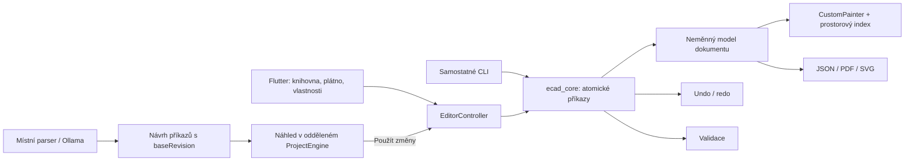

# Architektura prototypu

## Jedno jádro pro uživatele i asistenta



Doména je v `packages/ecad_core`; Flutter používá stejný model a příkazy jako CLI.
Formát v6 odděluje artikl (`Article`), fyzickou komponentu nebo materiál
(`Component`) a schématické zobrazení funkce (`Device`). Jeden kus může mít více
funkcí a výskytů; kusovník se počítá z komponent, nikoli ze značek. Materiál může
mít kusové množství, přesnou metráž nebo neurčené množství. JSON ukládá desetinné
množství jako řetězec s tečkou; české formuláře a množstevní buňky reportů používají
čárku. CSV exportuje buňky v uvozovkách, takže desetinná čárka nenaruší oddělení
sloupců. Text začínající znakem vzorce nebo tabulátorem či koncem řádku dostane
v CSV úvodní apostrof, aby jej tabulkový program nevyhodnotil jako vzorec.
Uložené údaje ani ostatní exporty se tím nemění.

`StructureContext` ukládá explicitní cesty funkčního (`=`), místního (`+`)
a nadřazeného produktového (`-`) aspektu. Místní označení komponenty je zvlášť
v `ComponentReference`; číslo listu a volitelný kód dokumentu jsou také samostatné.
Lomítka a tečky uvnitř úrovně se neštěpí. Identitu určují ID, unikátnost označení
celá struktura a místní název. Nový kus jednou převezme kontext listu; další
výskyt ani pozdější změna struktury listu jeho označení nemění. Resolver poskytuje
plná a relativní označení pro stromy, popisky, mezilistové odkazy, hover a reporty.

Obyčejná průchozí svorka má jednu fyzickou komponentu, jeden vodivý uzel a vlastní
číslo v logické `TerminalStrip`. Skupina nepřidává další kus do BOM.
`TerminalSymbolSpec` zobrazuje malý kruh s jedním až čtyřmi směry; jednotlivé
připojovací body mají vlastní označení a stabilní místní klíče při otočení.
Konektivita vzniká společným uzlem uvnitř konkrétní svorky, ne shodou svorkovnice.
Geometrie kruhu a ramen je společná pro canvas a export. Připojený směr nelze
odstranit bez odpojení. Staré bloky se na tento model automaticky nepřevádějí.

Vodič odkazuje na výskyt a stabilní ID jeho portu, případně na pokračovací značku.
Přejmenování vývodu ani posun značky spoj neodpojí. `WireRouter` sdílí geometrii
tras mezi editorem a exportem. Pokračovací značky spojuje explicitní vazba;
shodný text sám o sobě elektrické spojení nevytváří.

Listy mají typ schématu, montáže, formuláře nebo živého reportu. Montážní plocha
ukládá skutečné mm, další listy ji mohou zobrazit v jiném měřítku a výřezu. Společné
rozvržení montážních označení drží text uvnitř tělesa, pokud se vejde, případně
jej otočí nebo umístí ven s odkazovou čarou. Fyzické rozměry se kvůli textu nemění.
Canvas, PDF a SVG používají totožné pozice popisků. Živý report má také jediné
rozvržení pro obrazovku i export; stránkování nemění uložené listy ani množství.
Grafické objekty z PDF nemají automaticky elektrický význam.

Rámečky mají společný model v jádru. Projekt ukládá definice šablon, výchozí
volbu a údaje pro razítko; list dědí nastavení, vybírá vlastní šablonu nebo
rámeček výslovně vypíná. Obvod, razítko a souřadnicové zóny lze přepínat
samostatně. Poloha čar a textových polí je v milimetrech papíru. Údaje razítka
se doplňují z povolených vazeb na projekt, list a fyzickou stránku; revize
výkresu je editovatelný údaj nezávislý na revizi transakcí.

Rozvržení nejprve vyhradí pracovní oblast a rozstránkuje reporty, potom doplní
čísla a celkový počet fyzických stránek. Společná příprava textu rámečku řídí
plátno i SVG/PDF. Změna šablony nepřesouvá existující objekty ani nemění montážní
měřítko. Upozornění označí obsah mimo pracovní oblast a příliš dlouhý text;
neplatné stránkování zabrání exportu neúplného dokumentu. Úpravy šablon a údajů
procházejí stejnými atomickými příkazy a historií jako ostatní změny projektu.

Validace a data reportů se uchovávají pro neměnný snímek projektu. Stránkování
sestav má omezenou mezipaměť podle skutečného obsahu tabulky, papíru, pracovní
oblasti a fontů; posun značky ani textového pole razítka ho znovu nepočítá.
Rámečky a kontroly přesahů se připravují až pro zobrazenou stránku. Export
připraví a ověří celý dokument. Náhled úprav rámečku používá data sestav
z původního snímku a znovu počítá jejich stránkování při změně pracovní oblasti.

Panel projektu nabízí listy, knihovnu značek, komponenty a artikly. Formuláře
upravují společný zdroj údajů pro všechna zobrazení. Nové elektrické zobrazení
existujícího kusu a vytvoření dalšího kusu jsou samostatné operace. Smazání
výskytu zachová komponentu. Montáž podporuje tažení, otočení, měřítko a sdílené
pohledy; reporty zpřístupňují všechny odvozené stránky.

Dvojklik na schématický symbol nebo F4 otevře vlastnosti i při skrytém pravém
panelu. Tlačítko „Zobrazit vlastnosti“ panel opět otevře. Editory komponenty,
artiklu, funkce a vývodů zachovávají vazby přes ID. Dvojklik na montážní zobrazení
upravuje stejný fyzický kus. Stromy listů a přístrojů umožňují hledat plná i místní
označení a přepínat první aspekt seskupení; pohled nemění exportní pořadí listů.

`WorkspaceController` spravuje více dokumentových relací. Tab a životnost plátna
jsou určené dvojicí relace/list; rozpracovaná gesta nepřecházejí mezi dokumenty.
Asynchronní formulář upravuje původního vlastníka i při dokončení otevření jiného
projektu. Souběžná obnova stejné pracovní kopie ponechá jedinou relaci.

Všechna trvalá editace jde přes `ProjectEngine.execute`. Dávka se provede na
pracovní kopii, zkontroluje a zveřejní jako jedna nová revize. Chyba odmítne celou
dávku. Undo i redo zvětšují revizi, aby návrh asistenta nemohl omylem platit po
návratu ke zdánlivě stejným datům. Historie je paměťová a neukládá se do souboru.

## Asistent

`AssistantProposal` nese strukturované příkazy, vysvětlení, zdroj a výchozí revizi.
Náhled používá oddělený engine a plátno se při něm nedá upravovat. Dokument se
změní až po použití návrhu. Esc náhled zavře, návrh zahodí jen jeho odložení.
Ruční editace nad původním dokumentem zneplatní starý návrh. Změna listu nebo
projektu zneplatní rozpracovaný požadavek; opožděná síťová odpověď se nesmí
promítnout do nového kontextu. Po změně listu zůstane v konverzaci krátká zpráva
o zrušení požadavku.

Parser funguje bez internetu. Ollama adaptér žádá omezené JSON operace; nevyhodnocuje
modelový text jako kód. Oba poskytovatelé převádějí záměr na stejné doménové příkazy.
Skutečně obecné AI kreslení vyžaduje další operace, kontext spojů a vyhodnocování
kvality návrhů. Současný adaptér prokazuje cestu od zadání k vratné úpravě dokumentu.

Výchozí označení generuje společný alokátor v rámci struktury nového kusu.
Jednoduché staré `X1` a `-X1` rezervují pro automatické číslování v prázdné
struktuře totéž číslo. Staré neprůhledné označení se při otevření neparsuje ani
nepřepisuje; převod do struktury vyžaduje výslovnou editaci. Automatické vložení hledá místo uvnitř pracovní části listu,
rezervuje rozměry symbolů a přibližné rozměry popisků. Propojenou skupinu bere
konzervativně jako jeden obdélník. Zaplněný list vyvolá zprávu místo vložení mimo
výkres; nejde o obecný optimalizátor rozložení ani trasování. Ruční duplikace
výběru kopíruje podle stejných pravidel, včetně vodičů uvnitř výběru a společného
posunu grafiky. Omezuje ji jen velikost transakce jádra (1000 příkazů), nikoli
limit 100 změn pro návrh asistenta.

CLI umí tentýž příkazový protokol bez GUI. Příklad obálky:

```json
{
  "expectedRevision": 0,
  "label": "Přejmenování projektu",
  "commands": [{"type": "renameProject", "name": "Rozvaděč dílny"}]
}
```

## Vykreslování a e-ink

Plátno používá vektorový `CustomPainter`. Prostorový index vybírá viditelné
přístroje a vodiče; výběr pracuje v souřadnicích dokumentu. Tažení ukazuje náhled
a odešle jediný příkaz až při puštění. Omezena je velikost cache rozvržených textů.
Při velmi malém zoomu se vypustí nečitelné popisky a drobné tečky, geometrie
přístrojů a vodičů zůstává. Syntetický benchmark zahrnuje i tento režim.
Přerušovaná čára grafiky se rozloží na čárky jednou a s omezeným počtem kroků.
Vzor s periodou pod jeden pixel obrazovky, nebo příliš dlouhý pro tento limit,
se kreslí plnou čarou s průhledností podle podílu čárek. Uložený vzor i exporty
zůstávají přesné.

Barvy jsou centralizované v `EcadColors` a `CanvasPalette`. Dva kontrastní motivy
mají čisté černé/bílé plochy i ikony; výběr je čitelný obrysem a inverzí. E-ink
nemá zvláštní renderer. Vypnuté jsou animace změny motivu, splash efekty a plynulá
animace textového kurzoru. Standardní dialogy a některé Material ovládací prvky
si zachovávají krátké přechody; režim nebyl fyzicky měřen na e-ink panelu.

## Soubory a platformy

`ProjectPersistence` odděluje JSON dokument od platformních dialogů a prohlížečového
stahování. `.oecad` a `.ecad.json` jsou dvě přípony stejného formátu. Vstup se
kontroluje při dekódování i podle integrity grafu. GUI i CLI omezují soubor na
128 MiB. Pracovní kopie jsou oddělené podle relace a zápisy
jsou řazené, aby pomalejší zápis nepřepsal novější stav. Každá je omezená na
2 MiB a 15 000 grafických objektů; velké importy vyžadují explicitní uložení.
Uchovává se deset nejnovějších kopií mimo otevřené relace. Otevřené dokumenty
mají samostatně počítané držitele, takže ani souběžná obnova neumožní promazat
jejich kopie. Výslovné zavření po vyřešení změn odstraní kopii až za jejími
rozpracovanými zápisy; zavření celého okna vyřeší neuložené změny všech projektů
a dokončí zápis pracovních kopií, které zachová pro další spuštění.
Ve stejném záznamu nese revizi naposledy uloženou do souboru a jeho název, takže
obnova neoznačí uloženou práci za neuloženou ani novější změny za uložené.
Na desktopu probíhá převod PDF v odděleném procesu a JSON kódování/dekódování přes
`compute`. Převodník se hledá ve složce `scripts` vedle aplikace, při vývojovém
spuštění také přímo v pracovní složce, nikdy v jejích nadřazených složkách.
Proměnné `ECAD_PDF_IMPORTER` a `ECAD_PDF_PYTHON` mají přednost. Python běží
v režimu UTF-8, aby chybová zpráva převodníku zůstala čitelná. Ve webovém
sestavení `compute` zůstává na hlavním vlákně. Aplikace i převodník zapisují v6,
čtečka přijímá v4, v5 a v6. Chybějící struktura je prázdná a původní označení zůstává neprůhledným
textem. Starší formáty se odmítají bez automatické migrace.
Přímé spuštění binárky s `--project /cesta/projekt.oecad` má přednost před obnovou.
Otevření stejné kanonické cesty aktivuje existující dokument a zachová jeho změny.


Explicitní uložení pracuje se snímkem a identitou otevřeného dokumentu. Pozdní
dokončení ukládání nesmí označit mezitím otevřený projekt za uložený. Web vrací
soubor ke stažení; desktop používá nativní souborový dialog. PDF/SVG exportují
výkres podle téhož katalogu vývodů, ale vlastní kreslicí backend je zatím nutné
udržovat v souladu s plátnem. Čára nulové tloušťky je v PDF nejtenčí zobrazitelná
čára a PDF export ji tak zachová. Samostatné SVG ji zapisuje jako jednopixelovou
čáru s `vector-effect="non-scaling-stroke"`; čárky takové přerušované čáry pak
odpovídají pixelům zobrazení a s výkresem souhlasí v měřítku 1 : 1.

Flutter hostitelé jsou připravené pro Linux, Windows, macOS a web. Pluginy řeší
dialogy a preference. Mobilní hostitelé ani ovládání pro telefon zatím nejsou
součástí projektu. macOS má oprávnění pro uživatelem vybrané soubory a odchozí síť.

## Proč zatím Dart

Oddělené čisté jádro dovoluje měření a testování bez Flutteru. Zjištěná úzká místa
byla především v opakovaném rozvržení textů a hustém překreslování. Přepis datového
jádra do Go by tato místa sám neřešil. Nejprve dává smysl přesun náročných importů
nebo analýz mimo UI isolate a optimalizace konkrétních algoritmů.

Pro budoucí nativní algoritmus může vzniknout stabilní dávkové rozhraní; formát
příkazů a dokumentu nemusí být závislý na implementačním jazyce. Zavádět druhý
runtime a další platformní build bez naměřeného důvodu zatím nepřináší výhodu.

## Další ověření

Platformní souborové dialogy a přenosné sestavení je potřeba ověřovat na každé
cílové platformě. Import QET a pokročilé konstrukční kontroly nejsou součástí
současného modelu.
