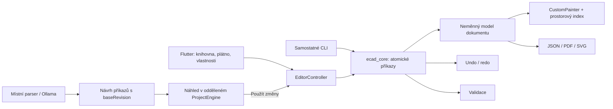

# Architektura prototypu

## Jedno jádro pro uživatele i asistenta



Doména je v `packages/ecad_core`; Flutter nemá vlastní paralelní model schématu.
Přístroj obsahuje typ, ID, označení, střed, otočení a textové údaje. Spoj odkazuje
na ID přístroje a jeho pojmenovaný vývod. Poloha konců se odvozuje z geometrie
symbolu, takže editace přístroje neodpojuje vodiče. Trasu počítá sdílený
`WireRouter` jádra pro plátno, náhled tažení i export. Přesun nebo otočení
přístroje upraví v téže revizi ruční zlomy u dotčeného vývodu. Ostatní zlomy
zachovává, pokud dovolují napojení bez průchodu připojenou značkou a ze správné
strany vývodu; jinak postupně přejde až k automatické trase. Dokument obsahuje
listy a revizi.
Typ listu (vícepólové a jednopólové schéma, výstavba rozvaděče, formulář) list
pojmenovává a třídí; pravidla editace, propojení i kontroly jsou pro všechny typy
stejná. Mění se vratným příkazem `setSheetType`.
Formát v2 přidal rozměry listu a nezávislé grafické objekty (cesty, texty, PNG),
formát v3 typ listu.
Grafika nemá automaticky elektrický význam. Místní Python převodník PDF vytváří
tyto objekty, editor i export pracují se stejným modelem bez původního PDF.

Všechna trvalá editace jde přes `ProjectEngine.execute`. Dávka se provede na
pracovní kopii, zkontroluje a zveřejní jako jedna nová revize. Chyba odmítne celou
dávku. Undo i redo zvětšují revizi, aby návrh asistenta nemohl omylem platit po
návratu ke zdánlivě stejným datům. Historie je paměťová a neukládá se do souboru.

## Asistent

`AssistantProposal` nese strukturované příkazy, vysvětlení, zdroj a výchozí revizi.
Náhled používá oddělený engine a plátno se při něm nedá upravovat. Dokument se
změní až po použití návrhu. Esc náhled zavře, návrh zahodí jen jeho odložení.
Ruční editace nad původním dokumentem zneplatní starý návrh. Změna listu nebo
projektu zneplatní rozpracovaný požadavek; opožděná síťová odpověď se nesmí
promítnout do nového kontextu. Po změně listu zůstane v konverzaci krátká zpráva
o zrušení požadavku.

Parser funguje bez internetu. Ollama adaptér žádá omezené JSON operace; nevyhodnocuje
modelový text jako kód. Oba poskytovatelé převádějí záměr na stejné doménové příkazy.
Skutečně obecné AI kreslení vyžaduje další operace, kontext spojů a vyhodnocování
kvality návrhů. Současný adaptér prokazuje cestu od zadání k vratné úpravě dokumentu.

Výchozí označení generuje společný katalog napříč všemi listy; například `X1`
a `-X1` rezervují pro automatické číslování totéž číslo. Uživatelova explicitní
označení se nemění. Automatické vložení hledá místo uvnitř pracovní části listu,
rezervuje rozměry symbolů a přibližné rozměry popisků. Propojenou skupinu bere
konzervativně jako jeden obdélník. Zaplněný list vyvolá zprávu místo vložení mimo
výkres; nejde o obecný optimalizátor rozložení ani trasování. Ruční duplikace
výběru kopíruje podle stejných pravidel, včetně vodičů uvnitř výběru a společného
posunu grafiky. Omezuje ji jen velikost transakce jádra (1000 příkazů), nikoli
limit 100 změn pro návrh asistenta.

CLI umí tentýž příkazový protokol bez GUI. Příklad obálky:

```json
{
  "expectedRevision": 0,
  "label": "Přejmenování projektu",
  "commands": [{"type": "renameProject", "name": "Rozvaděč dílny"}]
}
```

## Vykreslování a e-ink

Plátno používá vektorový `CustomPainter`. Prostorový index vybírá viditelné
přístroje a vodiče; výběr pracuje v souřadnicích dokumentu. Tažení ukazuje náhled
a odešle jediný příkaz až při puštění. Omezena je velikost cache rozvržených textů.
Při velmi malém zoomu se vypustí nečitelné popisky a drobné tečky, geometrie
přístrojů a vodičů zůstává. Syntetický benchmark zahrnuje i tento režim.
Přerušovaná čára grafiky se rozloží na čárky jednou a s omezeným počtem kroků.
Vzor s periodou pod jeden pixel obrazovky, nebo příliš dlouhý pro tento limit,
se kreslí plnou čarou s průhledností podle podílu čárek. Uložený vzor i exporty
zůstávají přesné.

Barvy jsou centralizované v `EcadColors` a `CanvasPalette`. Dva kontrastní motivy
mají čisté černé/bílé plochy i ikony; výběr je čitelný obrysem a inverzí. E-ink
nemá zvláštní renderer. Vypnuté jsou animace změny motivu, splash efekty a plynulá
animace textového kurzoru. Standardní dialogy a některé Material ovládací prvky
si zachovávají krátké přechody; režim nebyl fyzicky měřen na e-ink panelu.

## Soubory a platformy

`ProjectPersistence` odděluje JSON dokument od platformních dialogů a prohlížečového
stahování. `.oecad` a `.ecad.json` jsou dvě přípony stejného formátu. Vstup se
kontroluje při dekódování i podle integrity grafu. GUI i CLI omezují soubor na
128 MiB. Automatická kopie je jediný dokument v místním úložišti a zápisy
jsou řazené, aby pomalejší starý zápis nepřepsal novější stav. Je omezená na
2 MiB a 15 000 grafických objektů; velké importy vyžadují explicitní uložení.
Ve stejném záznamu nese revizi naposledy uloženou do souboru a jeho název, takže
obnova neoznačí uloženou práci za neuloženou ani novější změny za uložené.
Na desktopu probíhá převod PDF v odděleném procesu a JSON kódování/dekódování přes
`compute`. Převodník se hledá ve složce `scripts` vedle aplikace, při vývojovém
spuštění také přímo v pracovní složce, nikdy v jejích nadřazených složkách.
Proměnné `ECAD_PDF_IMPORTER` a `ECAD_PDF_PYTHON` mají přednost. Python běží
v režimu UTF-8, aby chybová zpráva převodníku zůstala čitelná. Ve webovém
sestavení `compute` zůstává na hlavním vlákně. Čtení v1 doplňuje výchozí rozměry
listu a prázdnou grafiku, čtení v1 a v2 náhradní typ listu. Nové soubory se
zapisují jako v3; starší čtečka je tak odmítne jako nepodporovaný formát, místo
aby hlásila neznámé pole.

Explicitní uložení pracuje se snímkem a identitou otevřeného dokumentu. Pozdní
dokončení ukládání nesmí označit mezitím otevřený projekt za uložený. Web vrací
soubor ke stažení; desktop používá nativní souborový dialog. PDF/SVG exportují
výkres podle téhož katalogu vývodů, ale vlastní kreslicí backend je zatím nutné
udržovat v souladu s plátnem. Čára nulové tloušťky je v PDF nejtenčí zobrazitelná
čára a PDF export ji tak zachová. Samostatné SVG ji zapisuje jako jednopixelovou
čáru s `vector-effect="non-scaling-stroke"`; čárky takové přerušované čáry pak
odpovídají pixelům zobrazení a s výkresem souhlasí v měřítku 1 : 1.

Flutter hostitelé jsou připravené pro Linux, Windows, macOS a web. Pluginy řeší
dialogy a preference. Mobilní hostitelé ani ovládání pro telefon zatím nejsou
součástí projektu. macOS má oprávnění pro uživatelem vybrané soubory a odchozí síť.

## Proč zatím Dart

Oddělené čisté jádro dovoluje měření a testování bez Flutteru. Zjištěná úzká místa
byla především v opakovaném rozvržení textů a hustém překreslování. Přepis datového
jádra do Go by tato místa sám neřešil. Nejprve dává smysl přesun náročných importů
nebo analýz mimo UI isolate a optimalizace konkrétních algoritmů.

Pro budoucí nativní algoritmus může vzniknout stabilní dávkové rozhraní; formát
příkazů a dokumentu nemusí být závislý na implementačním jazyce. Zavádět druhý
runtime a další platformní build bez naměřeného důvodu zatím nepřináší výhodu.

## Další ucelený krok

Na malém skutečném projektu ověřit ovládání ve Windows a význam doménových prvků.
Poté rozšířit model o logický přístroj oddělený od jeho zobrazení, vazby mezi listy
a vlastní symboly. Až tento model bude stabilní, navázat svorkovnice, kusovníky,
import QET a obecnější příkazy asistenta. Současný formát má číslo verze právě
proto, aby takový posun šel řešit explicitní migrací.
